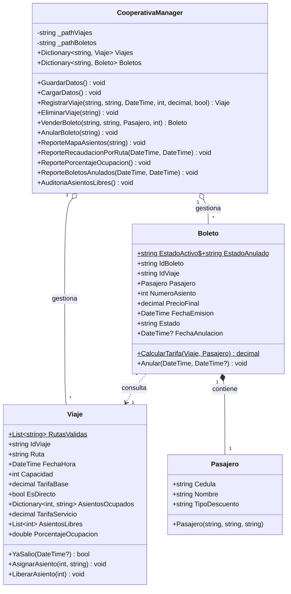

# Sistema de Gestión de Boletos - Cooperativa de Transporte Ibarra

Sistema de consola en **C# (.NET Core)** bajo Programación Orientada a Objetos (POO) con persistencia en archivos JSON.

## Integrantes
* Melody Criollo
* Steven Reyna
* Villy Reyes
* Alexis Pozo
* Alexander Vargas

## Requisitos y Entorno
* **IDE:** Microsoft Visual Studio 2022 o Visual Studio Code.
* **SDK:** .NET 7.0 o .NET 8.0.

## Instrucciones para Compilar y Ejecutar

### Desde Visual Studio:
1. Abrir la solución `CooperativaTransporte.slnx` o `CooperativaTransporte.sln`.
2. Verificar que los archivos dentro de la carpeta `Data/` tengan en sus propiedades la opción **Copiar en el directorio de salida: Copiar si es posterior**.
3. Presionar `F5` o el botón **Iniciar** para ejecutar en la consola interactiva.

### Desde la Terminal (.NET CLI):
```bash
dotnet build
dotnet run --project CooperativaTransporte
```

---

## Diagrama de Clases

